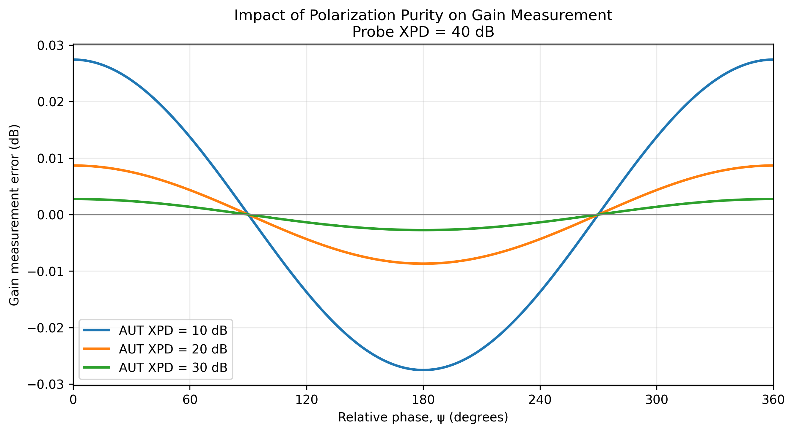
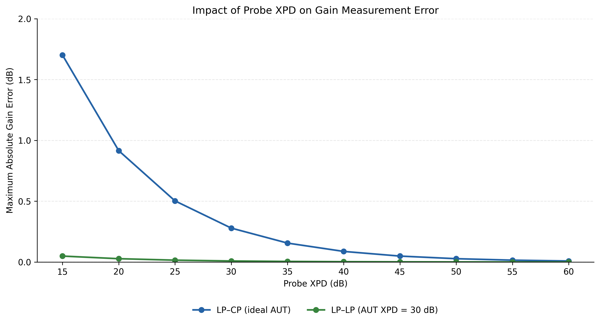

# Effect of Cross-Polarization on Gain Measurement Uncertainty

*Author: Hüseyin YİĞİT*, 24th November 2026

- [Effect of Cross-Polarization on Gain Measurement Uncertainty](#effect-of-cross-polarization-on-gain-measurement-uncertainty)
  - [1. Measurement model](#1-measurement-model)
  - [2. Definition of the AUT cross-polarization ratio](#2-definition-of-the-aut-cross-polarization-ratio)
  - [3. Obtaining the gain error](#3-obtaining-the-gain-error)
  - [4. Including the XPD values in the equation](#4-including-the-xpd-values-in-the-equation)
  - [5. Determining the bounds of the gain error](#5-determining-the-bounds-of-the-gain-error)
  - [6. Calculation of the standard measurement uncertainty](#6-calculation-of-the-standard-measurement-uncertainty)
  - [7. Graphical representation of the gain error and uncertainty](#7-graphical-representation-of-the-gain-error-and-uncertainty)
  - [8. Numerical example](#8-numerical-example)
  - [9. Case for a linearly polarized probe and a circularly polarized AUT](#9-case-for-a-linearly-polarized-probe-and-a-circularly-polarized-aut)
    - [9.1. H/V reconstruction model](#91-hv-reconstruction-model)
    - [9.2. Gain error bounds](#92-gain-error-bounds)
    - [9.3. Standard measurement uncertainty](#93-standard-measurement-uncertainty)
    - [9.4. Assumptions and conclusion](#94-assumptions-and-conclusion)
  - [References](#references)

## 1. Measurement model

Matrix representation of the measurement model:

$$
\begin{bmatrix} M_c\\ M_x \end{bmatrix}=
\begin{bmatrix}1&\epsilon_p\\-\epsilon_p&1\end{bmatrix}
\begin{bmatrix}F_c\\F_x\end{bmatrix}
$$

Because the co-polarization component is used in the gain measurement, we consider only the first row:

$$M_c=F_c+\epsilon_p F_x$$

Where:

- $M_c$: Measured complex co-polarization field.
- $F_c$: Actual co-polarization field of the AUT.
- $F_x$: Actual cross-polarization field of the AUT.
- $\epsilon_p$: Complex cross-polarization ratio of the probe antenna.

## 2. Definition of the AUT cross-polarization ratio

$$\epsilon_a=\frac{F_x}{F_c}$$

Therefore:

$$F_x=\epsilon_a F_c$$

Substituting this into the measurement equation:

$$M_c=F_c+\epsilon_p\epsilon_a F_c$$

$$M_c=F_c(1+\epsilon_p\epsilon_a)$$

## 3. Obtaining the gain error

Gain is proportional to the square of the electric-field magnitude. For the same co-polarization illumination magnitude:

$$\frac{G_m}{G_i}=\frac{|M_c|^2}{|F_c|^2}$$

Substituting:

$$\frac{G_m}{G_i}=|1+\epsilon_p\epsilon_a|^2$$

The gain error in dB:

$$\Delta G=20\log_{10}|1+\epsilon_p\epsilon_a|$$

## 4. Including the XPD values in the equation

Complex polarization ratios of the probe antenna and the AUT:

$$\epsilon_p=10^{-\frac{\mathrm{XPD}_p}{20}}e^{j\delta_p}$$

$$\epsilon_a=10^{-\frac{\mathrm{XPD}_a}{20}}e^{j\delta_a}$$

Their product:

$$\epsilon_p\epsilon_a=10^{-\frac{\mathrm{XPD}_p+\mathrm{XPD}_a}{20}}e^{j(\delta_p+\delta_a)}$$

To simplify the expression, define amplitude factor and phase seperately:

$$q=10^{-\frac{\mathrm{XPD}_p+\mathrm{XPD}_a}{20}}$$

$$\psi=\delta_p+\delta_a$$

Then:

$$\Delta G=20\log_{10}|1+qe^{j\psi}|$$

Expanding the magnitude of the complex expression:

$$\Delta G=10\log_{10}(1+q^2+2q\cos\psi)$$

## 5. Determining the bounds of the gain error

When the relative phase difference is unknown, two limiting cases are considered.

**Constructive interference ($\psi=0^\circ$):**

$$\Delta G_{\max}=20\log_{10}(1+q)$$

**Destructive interference ($\psi=180^\circ$):**

$$\Delta G_{\min}=20\log_{10}(1-q)$$

Therefore, the error bounds are:

$$\boxed{\Delta G_{\pm}=20\log_{10}\left(1\pm10^{-\frac{\mathrm{XPD}_p+\mathrm{XPD}_a}{20}}\right)}$$

## 6. Calculation of the standard measurement uncertainty

Convert logarithmic to linear scale for Taylor series expansion with $q\ll1$:

$$\Delta G_{\pm} = 20\log_{10}(1\pm q) = \frac{20}{\ln(10)}  \ln(1\pm q) = 
8.68589 \ln(1\pm q)$$

$$\ln(1\pm q)\approx\pm q \qquad \textit{Taylor series expansion first term}$$

Therefore:

$$\Delta G_{\pm}\approx\pm8.686q$$

Assuming a rectangular probability distribution, the standard uncertainty is:

$$u_G=\frac{8.686q}{\sqrt3}$$

**Final standard uncertainty equation:**

$$\boxed{u_G=\frac{8.686}{\sqrt3}10^{-\frac{\mathrm{XPD}_p+\mathrm{XPD}_a}{20}}\quad[\mathrm{dB}]}$$

## 7. Graphical representation of the gain error and uncertainty

The following figure illustrates the gain measurement error for a probe antenna with an XPD of 40 dB and AUT XPD values of 10, 20, and 30 dB.

## 8. Numerical example

Let the probe antenna XPD be 30 dB and the AUT XPD be 20 dB.

$$q=10^{-\frac{30+20}{20}}=0.003162$$

$$\Delta G_{\max}=+0.02742\;\mathrm{dB}$$

$$\Delta G_{\min}=-0.02751\;\mathrm{dB}$$

$$u_G \approx0.01586\;\mathrm{dB}$$

**Conclusion:** The gain measurement uncertainty depends on the sum of the probe antenna and AUT XPD values. For every 20 dB increase in this sum, the uncertainty decreases by approximately a factor of 10.

**Validity note:** 
- This model does not take into account gain calibration method uncertainty. It should be considered as an additional uncertainty contribution for the total gain measurement uncertainty.
- If the relative phase is assumed to have a uniform distribution instead of a rectangular distribution, $\sqrt3$ is replaced by $\sqrt2$ in the standard uncertainty calculation.
- This procedure is derived for far-field gain measurements. In near-field gain measurements, the cross-polarization ratio of the probe antenna may vary with distance, which can be additionally considered in the uncertainty evaluation.

## 9. Case for a linearly polarized probe and a circularly polarized AUT

Different from the previous case, since the AUT is circularly polarized its cross-polarization is close to 0 dB. Therefore, the gain measurement uncertainty is dominated by the probe antenna XPD value.

### 9.1. H/V reconstruction model

For coherent measurements of the two orthogonal linear components with a linearly polarized probe, the measured fields can be represented as:

$$
\begin{bmatrix}
M_H\\
M_V
\end{bmatrix}
=
\begin{bmatrix}
1 & \varepsilon_p^*\\
-\varepsilon_p^* & 1
\end{bmatrix}
\begin{bmatrix}
E_H\\
E_V
\end{bmatrix}
$$

where $\varepsilon_p=r_pe^{j\phi_p}$ is the complex cross-polarization coefficient of the probe and

$$
r_p=10^{-\frac{\mathrm{XPD}_p}{20}}
$$

The right- and left-hand circular components are reconstructed from the measured H/V fields using:

$$
M_R=\frac{M_H-jM_V}{\sqrt{2}},
\qquad
M_L=\frac{M_H+jM_V}{\sqrt{2}}
$$

Ideal 90° probe rotation and equal H/V channel balance give:

$$
\boxed{M_R=(1+j\varepsilon_p^*)E_R}
\qquad
\boxed{M_L=(1-j\varepsilon_p^*)E_L}
$$

The probe's cross-polarization coefficient therefore introduces the same magnitude correction to both circularly polarized components, with opposite complex signs.

### 9.2. Gain error bounds

The RHCP and LHCP gain errors are:

$$
\Delta G_R=20\log_{10}|1+j\varepsilon_p^*|,
\qquad
\Delta G_L=20\log_{10}|1-j\varepsilon_p^*|
$$

Defining the effective error coefficient

$$
\boxed{q=10^{-\frac{\mathrm{XPD}_p}{20}}}
$$

the worst-case gain error limits for either circular polarization component are:

$$
\boxed{
\Delta G_{\pm}
=20\log_{10}\left(1\pm10^{-\frac{\mathrm{XPD}_p}{20}}\right)
}
$$

For $q\ll1$, the first-order approximation is:

$$
\boxed{
\Delta G_{\pm}\approx
\pm8.686\times10^{-\frac{\mathrm{XPD}_p}{20}}\quad[\mathrm{dB}]
}
$$

### 9.3. Standard measurement uncertainty

For a conservative symmetric rectangular probability distribution, the standard gain measurement uncertainty is:

$$
\boxed{
u_G=
-\frac{20}{\sqrt{3}}
\log_{10}\left(1-10^{-\frac{\mathrm{XPD}_p}{20}}\right)
\quad[\mathrm{dB}]
}
$$

At sufficiently high probe XPD values:

$$
\boxed{
u_G\approx
\frac{8.686}{\sqrt{3}}
10^{-\frac{\mathrm{XPD}_p}{20}}
\quad[\mathrm{dB}]
}
$$

For example, a 30 dB probe XPD gives a maximum absolute gain error of approximately 0.279 dB and a standard uncertainty of approximately 0.161 dB.

In order to give clear distinction between two cases, following figure shows the gain measurement uncertainty differencefor a same linearly polarized probe. 

### 9.4. Assumptions and conclusion

The summarized result assumes:

- coherent measurement of the H and V components with accurate 90° phase difference;
- ideal CP AUT is thought to be worst case scenario for gain measurement error;
- a symmetric rectangular distribution for uncertainty evaluation.

Under these ideal reconstruction conditions, the error is independent of the AUT's XPD and axial ratio. It is determined by the probe XPD alone. Every 20 dB improvement in probe XPD reduces the first-order gain uncertainty by approximately a factor of ten.

## References

The analytical expressions presented in this article were derived from fundamental polarization coupling principles [3, 4], considering the antenna measurement framework described in [1, 2, 5] and the uncertainty evaluation methodology provided in [6].

1. E. Barry, P. Betjes, and E. Kim, “Measurement Uncertainties in Outdoor Far-field Antenna Ranges,” 2023.
2. IEEE Std 149-2021, *IEEE Recommended Practice for Antenna Measurements*, IEEE, 2021.
3. J. S. Hollis, T. J. Lyon, and L. Clayton, Jr., Eds., *Microwave Antenna Measurements*. Scientific-Atlanta, 1970.
4. C. A. Balanis, *Antenna Theory: Analysis and Design*, 4th ed. John Wiley & Sons, 2016.
5. C. Parini, S. Gregson, J. McCormick, and D. Janse van Rensburg, *Theory and Practice of Modern Antenna Range Measurements*. Institution of Engineering and Technology (IET), 2014.
6. JCGM 100:2008, *Evaluation of Measurement Data — Guide to the Expression of Uncertainty in Measurement (GUM)*, 2008.

